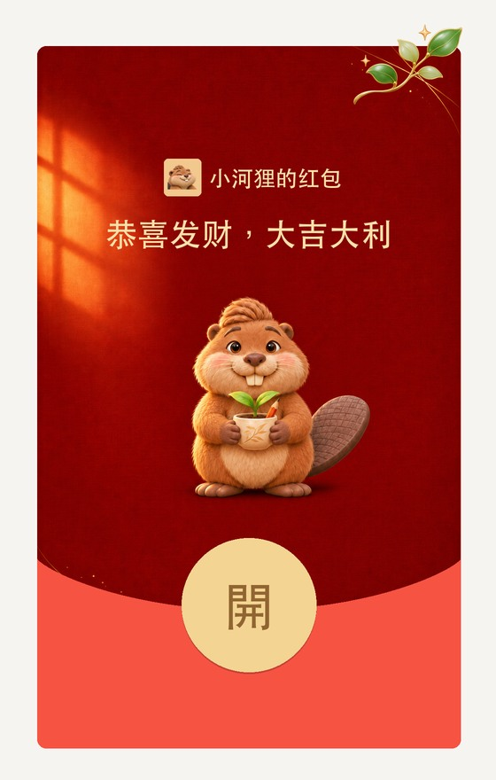

# Super Publisher

Super Publisher 是一套面向 AI Agent 的内容创作、素材加工和多平台发布技能。你可以在对话里制作表情包、红包封面、教程视频和图解，也可以把本地文章交给 Agent 处理并发布到微信公众号或今日头条。

[快速开始](#快速开始) · [常用场景](#常用场景) · [技能目录](docs/Skill_Guidelines.md) · [更新日志](CHANGELOG.md)

## 快速开始

在项目目录中使用 `skills` CLI 安装。可以安装全部技能，也可以按技能名选装。

```bash
# 安装全部技能
npx skills@latest add guanyang/super-publisher

# 只安装头条发布技能
npx skills@latest add guanyang/super-publisher --skill toutiao-publisher
```

### Claude Code 插件市场

在 Claude Code 中运行以下命令。

```text
/plugin marketplace add guanyang/super-publisher
/plugin install super-publisher@super-publisher
```

### 从本地仓库安装

在仓库根目录运行。脚本将技能软链接到目标目录，默认使用 `~/.agent/skills`。

```bash
./scripts/install-skills.sh
./scripts/install-skills.sh /path/to/your/workspace/.agents/skills
./scripts/install-skills.sh --delete /path/to/your/workspace/.agents/skills
```

也可以将技能复制到工作区的技能目录。

```bash
mkdir -p /path/to/your/workspace/.agents/skills
cp -r skills/* /path/to/your/workspace/.agents/skills/
```

将 `/path/to/your/workspace` 换成实际工作区路径。

## 常用场景

安装后可以直接用自然语言描述任务。需要明确指定时，在请求中加上技能名。

<a name="wechat-post-publisher"></a>

| 想做什么 | 可以这样说 |
| --- | --- |
| 发布文章 | 用 `wechat-post-publisher` 把 `release-note.md` 排版并存入公众号草稿箱。 |
| 做动态表情 | 用 `animated-sticker-maker` 让参考图里的小河狸抬手敬礼，先给一张循环动图小样。 |
| 做微信红包封面 | 用 `wechat-red-packet-designer` 做一张开工红包封面，先看完整构图和缩小效果。 |

### 从角色参考到微信表情整包

对 Agent 说「用 `sticker-factory` 把这只小河狸做成一套办公室表情，先看 16 宫格」。满意后可以直接说「输出整包」。流程会复用选定的网格，导出静态 PNG、缩略图、横幅及赞赏配图，并提供检查预览和 ZIP。完整流程见[表情包生产指南](skills/sticker-factory/README.md)。

## 成果示例

| 办公室表情 16 宫格 | 「收到」循环动图 | 微信拆红包页示意 |
| :---: | :---: | :---: |
| <a href="docs/images/sticker-factory-office-preview.jpg"></a> | <a href="docs/images/animated-sticker-received.gif"></a> | <a href="docs/images/wechat-red-packet-workstart.jpg"></a> |

## 技能目录

按手头的素材和想要的成品选技能。

- [内容发布](docs/Skill_Guidelines.md#内容发布)
- [表情与动图](docs/Skill_Guidelines.md#表情与动图)
- [微信红包封面](docs/Skill_Guidelines.md#微信红包封面)
- [教程视频与可编辑图解](docs/Skill_Guidelines.md#教程视频与可编辑图解)

## 贡献与维护

技能各自存放在 `skills/`，项目文档在 `docs/`，本地安装脚本在 `scripts/`，Claude Code 插件配置在 `.claude-plugin/`。

新增技能可从模板开始，在技能目录补一条使用说明，并在更新日志记录变更。[Agent Skills 规范](spec/Specification.md) · [技能模板](template/SKILL.md) · [技能目录](docs/Skill_Guidelines.md) · [更新日志](CHANGELOG.md)

本项目采用 [MIT 许可证](LICENSE)。
