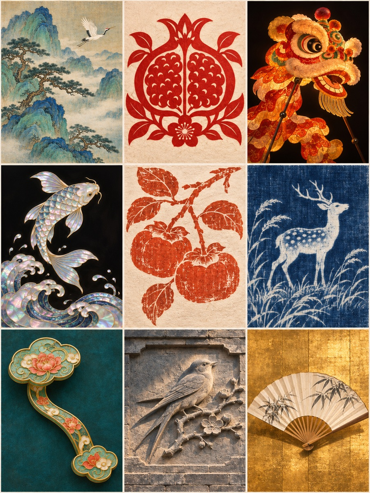
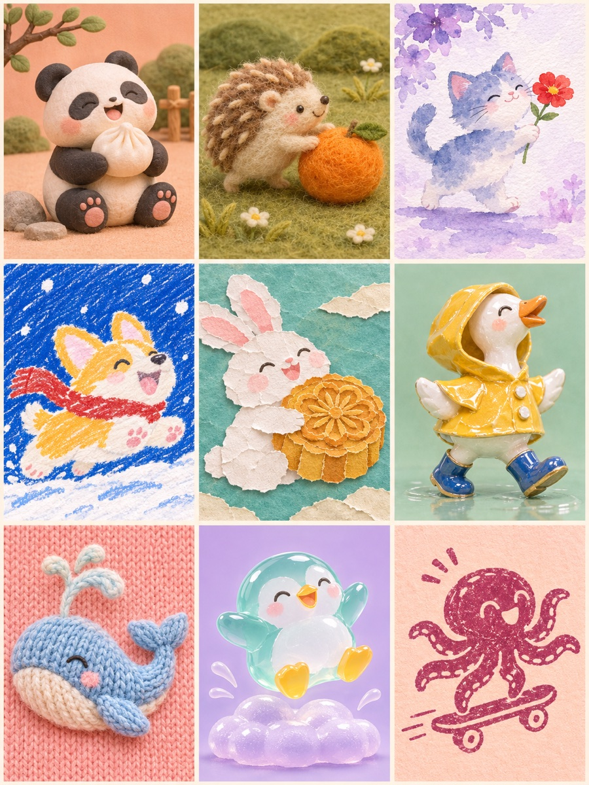
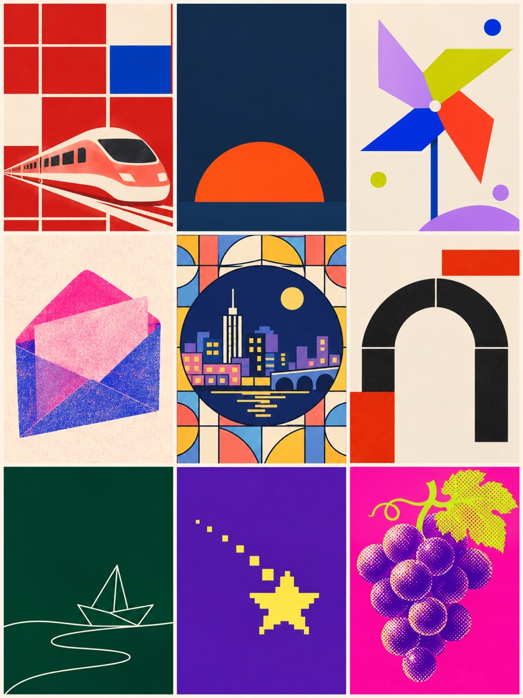
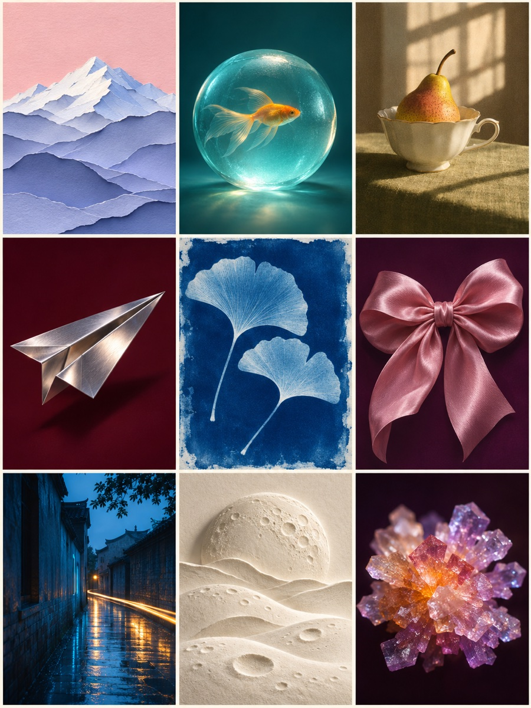
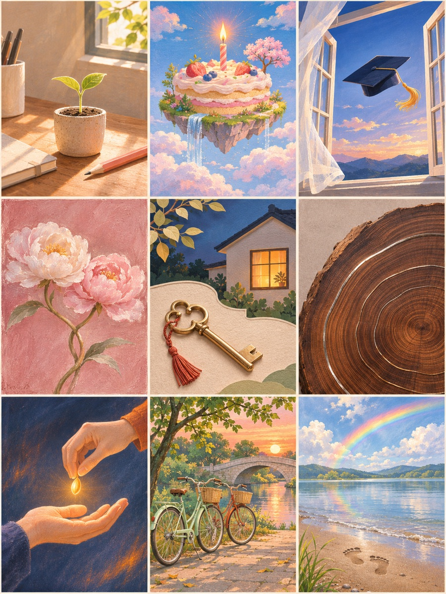

# 红包封面风格参考

未指定风格时，按场合和主体从相近的一组挑选方向。只在用户要求看样张或比较风格时展示相关组。每组按从左到右、从上到下对应 1–9。样张由内置 ImageGen 按各格的题材与视觉要点制作。用于新封面时，提取选中项的材质、配色或构图思路，按用户的主题重新制作独立竖图。

## A · 传统工艺

| 编号 | 风格与题材 | 视觉要点 |
| --- | --- | --- |
| A1 | 青绿山水 · 松鹤 | 石青石绿、叠山和云雾留白 |
| A2 | 民俗剪纸 · 石榴 | 朱红对称切纹、暖纸底 |
| A3 | 透光皮影 · 醒狮 | 深色背景、琥珀逆光、关节细节 |
| A4 | 螺钿镶嵌 · 跃鲤 | 黑漆底、虹彩贝壳、细金边 |
| A5 | 木刻拓印 · 柿子 | 朱砂印痕、纸纤维、简练的枝叶 |
| A6 | 蓝染布花 · 白鹿 | 靛蓝织纹、白色防染图案 |
| A7 | 掐丝珐琅 · 如意 | 金丝隔色、松石绿、珊瑚红 |
| A8 | 灰砖浮雕 · 燕子 | 手凿石纹、横斜侧光 |
| A9 | 金箔屏风 · 折扇 | 暖金箔面、白纸折褶、墨色枝叶 |

## B · 角色插画

| 编号 | 风格与题材 | 视觉要点 |
| --- | --- | --- |
| B1 | 定格黏土 · 团子熊猫 | 圆润手塑体块、软阴影和杏色布景 |
| B2 | 针毡玩偶 · 推橘刺猬 | 短纤维、橄榄色绒毡、暖橘点色 |
| B3 | 湿画水彩 · 小猫送花 | 薄透晕染、浅紫纸纹、单朵红花 |
| B4 | 粗蜡笔 · 雪地柯基 | 可见笔触、蓝白大色块、奔跑姿态 |
| B5 | 撕纸拼贴 · 月饼兔 | 锯齿纸边、浅青底和纸层阴影 |
| B6 | 彩釉玩具 · 雨衣小鹅 | 光滑亮釉、雨衣黄和水靴蓝 |
| B7 | 毛线手作 · 喷水鲸鱼 | 针织线圈、柔蓝鲸身、珊瑚色底 |
| B8 | 透亮果冻 · 云朵企鹅 | 半透明体块、柔紫背景、亮弧高光 |
| B9 | 橡皮章 · 滑板章鱼 | 限色油墨、断续印纹、简明动作 |

## C · 现代平面

| 编号 | 风格与题材 | 视觉要点 |
| --- | --- | --- |
| C1 | 瑞士网格 · 启程列车 | 栅格构成、红白块面、少量钴蓝 |
| C2 | 双色极简 · 海平面日出 | 深蓝留白、橙色半圆、干净地平线 |
| C3 | 孟菲斯几何 · 彩色风车 | 高饱和几何片、少量圆点 |
| C4 | 孔版叠印 · 展开的信封 | 桃红和钴蓝叠色、套印颗粒 |
| C5 | 彩窗镶嵌 · 圆窗城市 | 黑线分格、彩块、圆形取景 |
| C6 | 粗野主义 · 砖块拱门 | 黑红重块、硬直边、暖白底 |
| C7 | 一笔线描 · 湖上纸船 | 深绿大留白、连续细白线 |
| C8 | 街机像素 · 方格流星 | 明黄与深紫、阶梯边缘 |
| C9 | 荧光丝网 · 葡萄 | 洋红底、荧光绿叶、半调网点 |

## D · 光影与空间

| 编号 | 风格与题材 | 视觉要点 |
| --- | --- | --- |
| D1 | 层叠纸雕 · 雪山 | 多层纸边、淡紫阴影、粉色天空 |
| D2 | 磨砂玻璃 · 球中金鱼 | 琥珀鱼身、青蓝散射光、深色空间 |
| D3 | 胶片静物 · 瓷杯与梨 | 暖窗光、亚麻面、长投影 |
| D4 | 镜面折纸 · 纸飞机 | 银色折面、锐利反光、深红背景 |
| D5 | 植物蓝晒 · 银杏叶 | 普鲁士蓝、叶片留白、显影边缘 |
| D6 | 绸缎折叠 · 蝴蝶结 | 粉色柔光、成形褶皱、酒红背景 |
| D7 | 长曝光摄影 · 雨巷 | 蓝调、湿地倒影、暖色光迹 |
| D8 | 哑光陶瓷 · 月面山丘 | 米白浮雕、月坑、低角度侧光 |
| D9 | 微距摄影 · 彩盐晶花 | 晶体反光、琥珀到紫色渐层 |

## E · 送礼场合

| 编号 | 场合与题材 | 构图要点 |
| --- | --- | --- |
| E1 | 开工 · 桌面新芽 | 窗边幼苗、铅笔、晨光 |
| E2 | 生日 · 云中蛋糕岛 | 一支亮着的蜡烛、漂浮甜点岛 |
| E3 | 毕业 · 飞向窗外的学士帽 | 开窗取景、斜向动势、蓝金对比 |
| E4 | 婚礼 · 双花交茎 | 两朵芍药、柔粉油画质感 |
| E5 | 乔迁 · 钥匙与亮窗 | 前景黄铜钥匙、远景一扇暖窗 |
| E6 | 周年 · 木纹年轮 | 深木色圆心、少量嵌银线 |
| E7 | 感谢 · 递出光种 | 两只手的交接、深蓝对暖橙 |
| E8 | 重逢 · 桥边单车 | 并排车身、傍晚石桥和水面 |
| E9 | 日常祝福 · 雨后湖岸 | 彩虹、湖面倒影与岸边脚印 |
